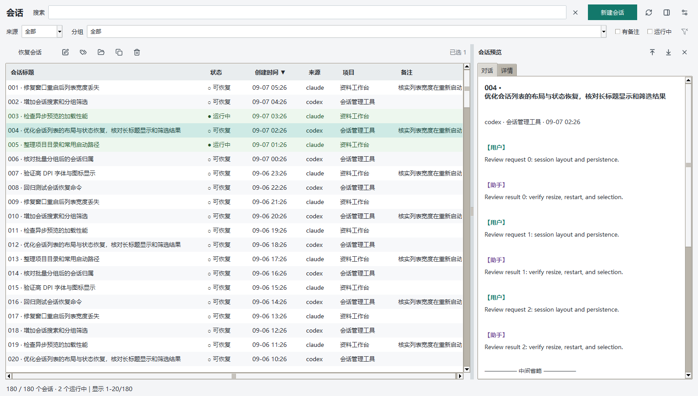

# CLI 会话管理器

Windows 桌面工具，用于浏览、筛选、预览和恢复 Claude Code 与 OpenAI Codex CLI 会话。程序只使用 Python 标准库和 Tkinter，保持 `session_launcher.py`、`assets/` 与主脚本同目录即可运行。



## 启动

双击 [CLI会话管理器.bat](CLI会话管理器.bat)。启动器优先使用 `pythonw` 隐藏控制台，找不到时回退到 `python`。也可以直接运行 `python cli_session_manager.py`。需要 Python 3.10+，并确保安装了 Tkinter。

程序使用 Windows 单实例互斥量。重复双击会唤回已打开的窗口，不会强制结束原进程。

## 首次打开与布局记忆

首次打开会按当前显示器工作区自适应为大窗口，默认列表占约 68%，最小尺寸为 900x540（按 DPI 缩放）。窗口放在副屏或负坐标位置后，重启时会根据当前工作区夹紧到可见范围。

以下状态会自动保存：

- 正常窗口尺寸、最大化状态和预览面板开关
- 列宽、可见列、行距模式、分隔条比例和横向滚动位置
- 搜索、分组、来源、备注/运行筛选、排序方向
- 选中会话和列表顶部位置

调整后约 350ms 自动写入设置，关闭时再保存一次。最小化不会覆盖最近一次正常尺寸；坏设置会被过滤并恢复可用默认值。拖动分隔条可调整列表与预览比例，双击分隔条恢复 68%。设置菜单提供“适应窗口”和“重置布局”。

表格有水平滚动条。列宽不足时可拖动表头边界；**双击列边界**会按当前可见内容自动适配，双击列标题本身不会触发恢复会话。

## 界面与工作流

顶部提供搜索、来源和分组筛选，以及“有备注”“运行中”复选框。搜索会匹配标题、项目、路径、Session ID、备注和分组，并在输入停止后防抖过滤。列表采用可视窗口渲染，状态栏显示当前显示范围。

右侧预览分为“对话”和“详情”页签。对话预览在后台线程读取，连续快速切换时会丢弃过期结果，界面仍可操作；详情页展示项目、来源、分组、目录、Session ID、备注和文件路径。大文件只读取有限头尾内容，小 Claude JSONL 会完整展示少量轮次。

工具栏和右键菜单支持恢复、编辑备注、修改分组、打开项目目录、打开 JSONL、复制 Session ID 和移入回收站。单选操作在多选时自动禁用；分组与复制 ID 支持批量选择。删除是文件层面的可恢复移动，不会直接永久删除。

“新建会话”使用独立窗口，可分别选择 `claude` 或 `codex`、两个常用项目目录和授权选项。CLI 来源与列表筛选相互独立；选择目录后会实际保存快捷路径。

恢复和新建会话均打开独立 CMD。CLI 退出后窗口会保留，并显示实际退出码；错误信息直接显示在终端。每次启动使用独立的临时请求文件，读取后自动清理，启动信息与退出码保存在 `%TEMP%/cli_session_*.log`。中文、空格、`%`、`!`、`&` 和括号路径按原值传递。

新建和恢复 Codex 会话时，均通过 Codex 的 `config/read` 检查当前项目的有效配置。当前 provider 缺失时显示明确错误，不猜测其他服务。恢复时若历史 provider 已移除，自动使用当前提供方和模型，并通过 `-c` 补充仅本次启动生效的历史 provider 别名，兼容恢复阶段先解析旧 provider 的行为。已配置的历史 provider 保持原样。管理器不改写全局配置或历史 JSONL；Codex 正常运行仍会保存会话。配置检查在新终端中执行，不阻塞管理器，也不发起模型对话。查询不受支持或失败时，交由 CLI 启动并显示实际错误。

CLI 每次启动重新检测，优先使用 PATH 中的 Windows `.cmd`/`.exe` 入口。设置了 `CODEX_HOME` 时，Codex 会话、标题、历史和启动配置使用同一数据目录。日志会分别记录配置检查、CLI 启动和退出状态；CLI 自身输出保留在终端，不会复制到启动日志中。

Claude 同样遵循 `CLAUDE_CONFIG_DIR`。Windows 下恢复 Claude 优先传入所选 JSONL 文件，原项目迁移、删除或重新选择工作目录后仍能找到会话。已通过 Claude 2.1.220 真实新建、恢复、目录迁移、上下文回忆和错误窗口检查。本轮共 51 个回归测试通过；两次早期短回复尚未确定原因。

常用快捷键：

| 快捷键 | 操作 |
|---|---|
| `Enter` | 恢复选中的单个会话 |
| `Delete` | 删除选中的会话（移入回收站） |
| `F5` | 刷新 |
| `Ctrl+F` | 聚焦搜索 |
| `Ctrl+P` | 显示/隐藏预览 |
| `Ctrl+N` | 打开新建会话 |
| `Ctrl+A` | 选择当前筛选结果 |
| `Ctrl+C` | 复制选中 Session ID |
| `Ctrl+D` | 编辑备注 |
| `Esc` | 清除选择；在搜索框中清空搜索 |
| `Shift+滚轮` | 横向滚动列表 |

## 数据来源与持久化

| 来源 | 会话记录 | 标题/历史 |
|---|---|---|
| Claude Code | `~/.claude/projects/` 下的 JSONL | `~/.claude/history.jsonl` |
| Codex CLI | `~/.codex/sessions/YYYY/MM/DD/` 下的 rollout JSONL | `~/.codex/session_index.jsonl`、`~/.codex/history.jsonl` |

Codex 同一 Session ID 的多个 rollout 会聚合成一行，恢复和删除会覆盖该会话的全部 rollout。Claude 的存活状态来自 PID 元数据；Codex 在没有 PID 的情况下使用最近 60 秒文件写入时间作为启发式判断。备注、分组、新建路径和 UI 设置位于 `~/.claude-internal/`，均通过临时文件、fsync 和原子替换写入。

## 验证

在项目目录逐条运行：

```powershell
python -m py_compile cli_session_manager.py session_launcher.py
python -m unittest discover -s tests -v
python tests/runtime_smoke.py
python tests/codex_protocol_smoke.py
python tests/visual_smoke.py
```

2026-10-01：48 个测试通过，其中 26 个覆盖启动与配置恢复。隔离环境下使用真实 Codex 0.159.2 复现 `Model provider custom not found`，并验证新建、临时别名恢复和当前 provider 路由；不发送模型请求。配置查询新增“后代进程继承 stdout”回归，验证查询完成后不会阻塞关闭管道，并回收对应进程。

本轮运行时检查读取真实数据 413 条，首轮加载 2.167 秒且事件循环持续响应（48 次 tick）；重复启动复用原进程，重启保留布局、筛选、选中项和滚动位置，回调错误为空。之前的合成数据视觉检查覆盖桌面、窄窗口、长条件、详情、空状态、紧凑行距、对话框和 Tk 150% 缩放，全部 `out_of_bounds=[]`；本轮未修改布局，未重跑截图。

## 资源许可

`assets/icons.png` 与 `assets/icons.json` 是离线 Lucide 图标图集，许可文本见 [assets/lucide-LICENSE](assets/lucide-LICENSE)。重新生成图集是可选的开发步骤，需要 Node.js、`@resvg/resvg-js` 和 `pngjs`；运行时不需要这些开发依赖。
